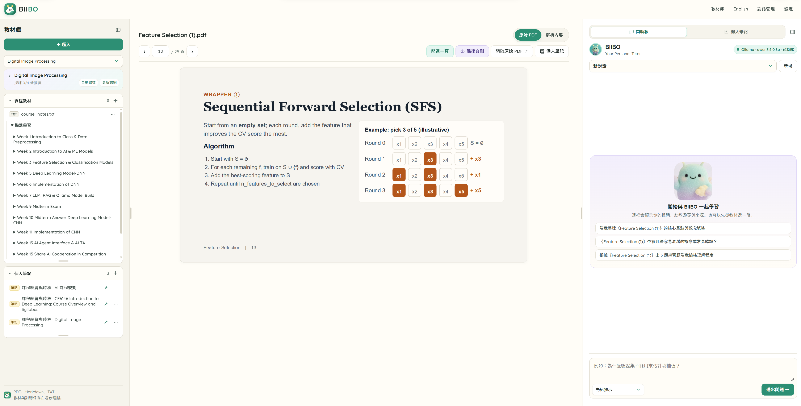
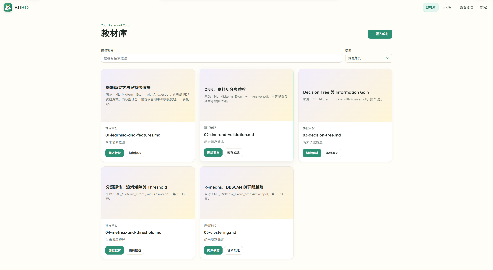
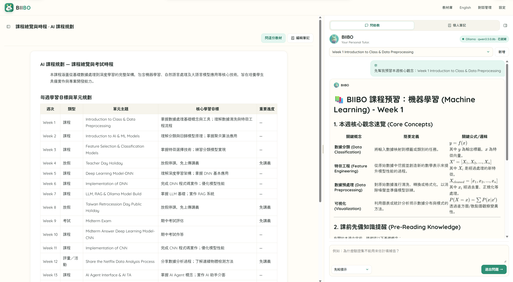
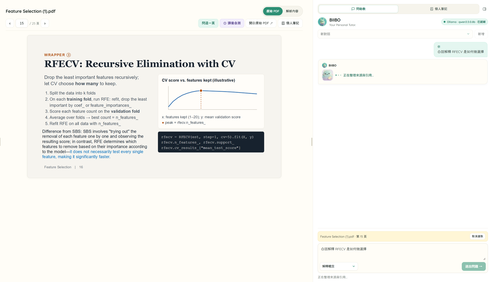
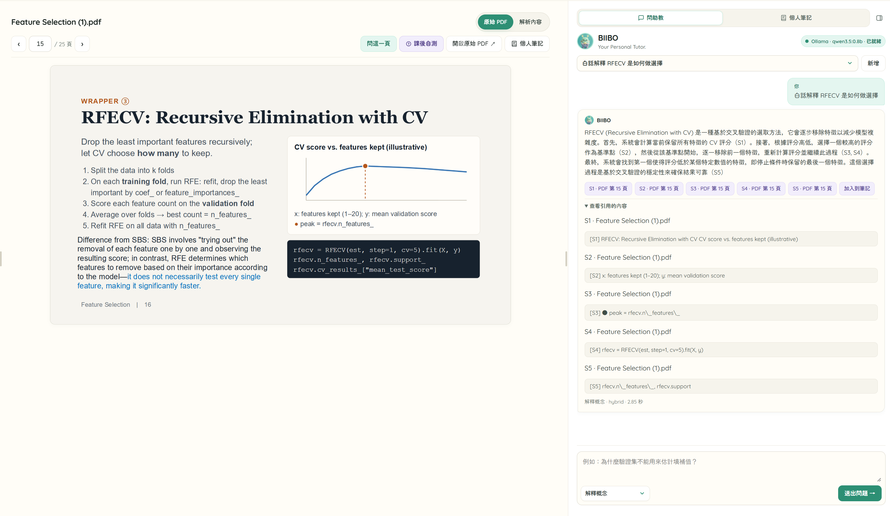
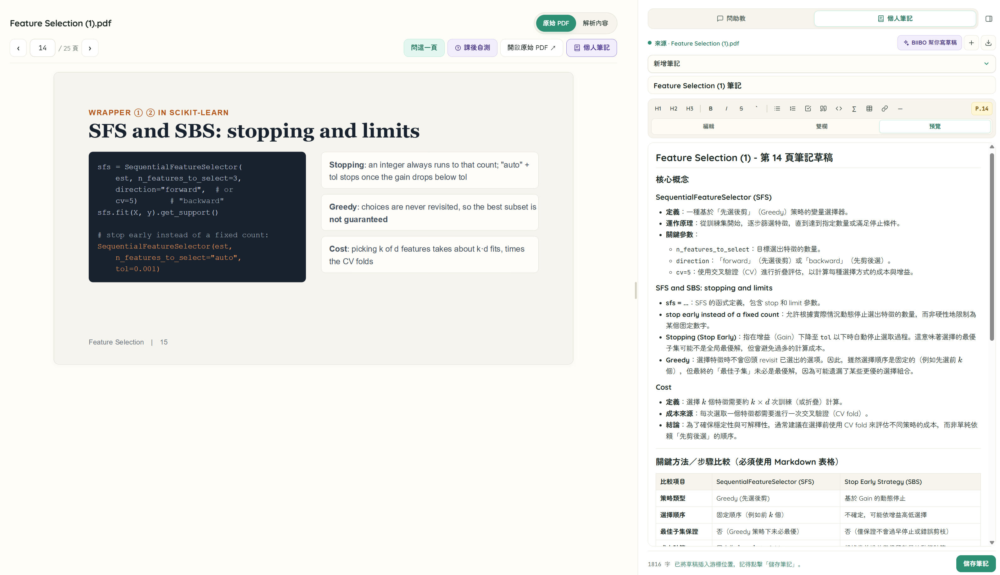
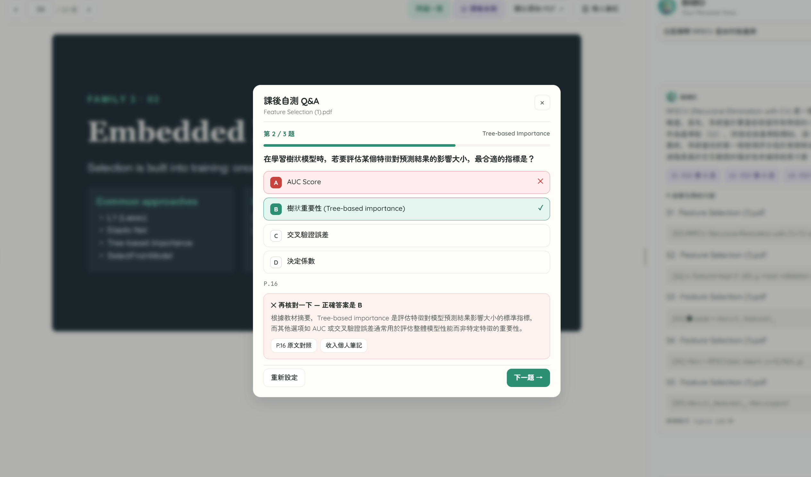
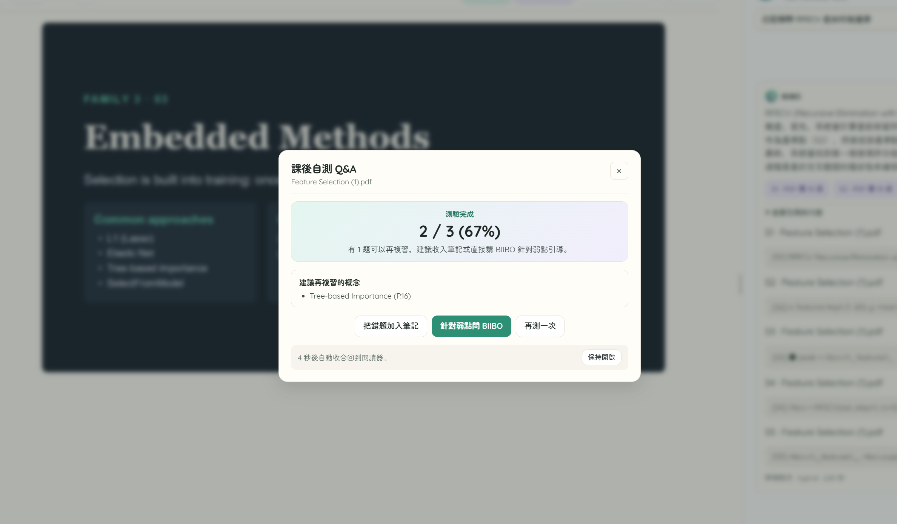

# BIIBO · Local Personal AI Tutor

**English** | [繁體中文](aita/README.md)

> **A local-first personal AI tutor and course workspace for students and researchers** — uniting PDF reading, MinerU structured parsing, automated syllabus planning, page-cited Socratic Q&A, Markdown/KaTeX note-taking, and self-test quizzes on your own machine.

BIIBO solves the fragmented study workflow where lecture slides, PDFs, notes, and AI chats live in disconnected tools. Everything stays organized by course and physical PDF page, with every answer and quiz question grounded in clickable citations back to the original material.

---

## Highlights & Demo

### 1. Unified Three-Pane Workspace & Course Library

Browse all courses and materials in `/library` with instant search and type filtering, then open the three-pane workspace to navigate weekly course folders, read original PDFs or parsed content on the exact same physical page, highlight in four colors, and chat with BIIBO side by side.

**Study Workspace**



**Material Library (`/library`)**



### 2. Automated Syllabus Planning & Weekly Pre-Class Preview

Upload a syllabus (PDF, screenshot, clipboard image `Ctrl+V`/`Cmd+V`, Markdown, or TXT) to run BIIBO's **3-stage automated pipeline** (`MinerU parsing → LLM planning → weekly folders & pinned overview note`). BIIBO adapts flexibly to any course schedule—skipping empty slide folders for holidays, exams, or peer-review weeks—and lets you trigger one-click weekly pre-class previews with KaTeX math summaries.



### 3. Page-Cited AI Tutor (Socratic Hints, Concepts & Debugging)

Click **Ask this page** or highlight any passage to ask BIIBO in **Hint**, **Concept**, or **Debug** mode. Responses include numbered inline citations (`S1`, `S2`, ...) that jump straight to the exact PDF page, expandable source excerpts, and one-click saving into your personal notes.

| Thinking Progress Display | Grounded Citations & Excerpts |
| :---: | :---: |
|  |  |

### 4. Markdown + KaTeX Personal Notes & AI Draft Assistant

Write notes alongside your PDF in **Edit**, **Split**, or **Preview** mode with full Markdown and LaTeX (`$...$` / `$$...$$`) support. Use **Draft with BIIBO** to generate structured summaries, formula sheets, or comparison tables from either the current page or the full document (evenly page-sampled for long PDFs), preview the result, and insert or append it into your notes. Saved notes are indexed for future tutor retrieval.



### 5. Focused Self-Test Q&A & Weak-Spot Review

Generate 3- or 5-question quizzes from the current page or the entire PDF. Each question comes with step-by-step hints, instant explanations, and clickable page jumps (automatically pausing and preserving your quiz progress while you review the slide). After finishing, clip missed questions to your notes or launch a targeted weak-spot session with BIIBO.

| Interactive Quiz with Source Jump | Quiz Summary & Weak-Spot Handoff |
| :---: | :---: |
|  |  |

### 6. Multi-Engine AI Support & Local-First Privacy

Choose your preferred AI engine directly in **Settings**, with independent UI language and tutor response language (Traditional Chinese / English):

| Category | Supported Engines |
| :--- | :--- |
| **Local Models** | **Ollama** (default), **LM Studio** |
| **Local CLI** | **Antigravity CLI**, **Claude Code**, **Codex CLI** (uses your local CLI login; supports reasoning effort & Fast mode) |
| **Cloud API** | **Gemini**, **OpenAI**, **Claude**, **OpenCode**, **DeepSeek**, **OpenRouter** |

All documents, folders, notes, conversations, and course plans are persisted locally in `./data/biibo-store.json` and `./data/blobs/`.

---

## PDF Parsing Engine: MinerU

BIIBO uses **[MinerU](https://github.com/opendatalab/MinerU)** as its primary local PDF and image parsing engine (`http://127.0.0.1:8000` by default, configurable via `AITA_MINERU_URL`).

**Why MinerU?**
- Accurately extracts multi-column academic layouts, tables, embedded figures, and LaTeX mathematical formulas into structured Markdown and page-mapped blocks.
- Provides OCR for scanned PDFs and syllabus screenshots (`PNG` / `JPG` / `WebP` / clipboard paste).
- If local MinerU is offline, BIIBO automatically falls back to built-in **PDF.js** text extraction for digital PDFs (you can also import a PDF together with a pre-generated MinerU ZIP bundle).

### Agent Prompt: Deploy Local MinerU Automatically

Copy and paste the prompt below into your local coding agent (such as **Claude Code**, **Codex CLI**, **Antigravity**, or **Cursor**) to install, launch, and verify a local MinerU HTTP service compatible with BIIBO:

```text
Please deploy a local MinerU HTTP API service on this machine for BIIBO (Local Personal AI Tutor):

1. Detect my OS, Python version, and hardware acceleration (NVIDIA CUDA GPU, Apple Silicon MPS, or CPU-only) and choose the most suitable MinerU installation method (prefer `uv` or an isolated Python virtual environment).
2. Install MinerU (`mineru[all]` or the appropriate official package for my hardware) and download any required OCR/layout models if prompted.
3. Start the local MinerU HTTP API server bound to loopback on port 8000 (`http://127.0.0.1:8000`, e.g., `mineru-api --host 127.0.0.1 --port 8000` or the equivalent server entry point for the installed version).
4. Verify the service is healthy by requesting `GET http://127.0.0.1:8000/openapi.json` and confirming that either `/file_parse` or `/v1/tasks` is exposed in the OpenAPI schema.
5. Check `.env` in this repository (create from `.env.example` if missing) and ensure `AITA_MINERU_URL=http://127.0.0.1:8000` is configured.
6. Provide me with the exact single command to restart the MinerU service in the future.
```

---

## Quick Start

### Prerequisites

- **Node.js 22+** (Node.js 24 recommended) and **Bun** (or `npm`)
- **Ollama** (for local-first usage) — or any supported Local CLI / Cloud API provider
- *(Optional)* Local **MinerU** at `http://127.0.0.1:8000` for high-accuracy PDF layout, math, table, and image OCR parsing

### Installation & Run

1. **Install dependencies and pull a local model** (with Ollama running):

```bash
# Using Bun (recommended)
bun install --frozen-lockfile
ollama pull qwen3.5:0.8b
bun run start
```

```bash
# Or using npm
npm install
ollama pull qwen3.5:0.8b
npm run start
```

2. *(Optional)* **Enable Dense / Hybrid RAG retrieval** (TF-IDF works out of the box):

```bash
ollama pull bge-m3
```

3. **Open BIIBO** in your browser:

```text
http://127.0.0.1:3000/library
```

4. *(Optional)* **Customize environment variables**:

```bash
cp .env.example .env
```

Edit `.env` to adjust `HOST`, `PORT`, `OLLAMA_URL`, `LMSTUDIO_URL`, `AITA_MINERU_URL`, or server-side Cloud API keys.

### Common Workflows

| Task | How to do it |
| :--- | :--- |
| **Import PDFs or MinerU ZIPs** | Click **+ Import** in `/library` or the sidebar. Upload a PDF (parsed automatically by local MinerU with PDF.js fallback), or select both a PDF and its MinerU results `.zip`. |
| **Plan a Course from Syllabus** | Open **Import → Syllabus plan**, upload a PDF/image, paste a screenshot (`Ctrl+V`/`Cmd+V`), or paste text, then click **Start AI planning**. BIIBO runs the 3-stage automated flow to build weekly folders and a pinned course overview note. |
| **Link Markdown Notes to PDF Pages** | In a UTF-8 Markdown file, add `<!-- page: N -->` (1-based physical page number) on its own line below a heading, then pick the matching source PDF during import. |
| **Mark Official Course Policies** | Check **official announcement** when importing syllabus rules or grading policies so BIIBO treats them as authoritative references. |
| **Switch AI Engines** | Open **Settings** to switch between **Local Models** (Ollama / LM Studio), **Local CLI** (Antigravity / Claude Code / Codex), and **Cloud API**. Cloud keys entered in the UI are saved locally to the Git-ignored `data/provider-keys.json`. |
| **Review & Export Conversations** | Open **Conversations** in the top bar to preview past threads and batch-export selected chats as **AITA JSON** or **Markdown**. |

### Upgrade from Python AITA & Backups

- On first startup, if `data/biibo-store.json` does not yet exist, BIIBO reads `aita/data/aita.sqlite3` (or the directory set in `AITA_DATA`) in read-only mode and migrates documents, chunks, folders, notes, conversations, and settings into `data/biibo-store.json` and `data/blobs/`.
- Stop BIIBO and back up the entire `data/` directory to preserve your library (keep `data/provider-keys.json` private).
- To keep browser preferences (highlights and reading positions) from a previous `127.0.0.1:8766` setup, set `PORT=8766` in `.env` before starting.

### Network Access & Security

BIIBO binds to loopback (`127.0.0.1`) by default for single-user local security. If you intentionally expose it over a network, set `HOST`, `BIIBO_ACCESS_TOKEN`, and the exact HTTPS `BIIBO_PUBLIC_ORIGIN` behind a reverse proxy that preserves the public `Host` header (sign in with username `biibo` and your token as password, or pass `Authorization: Bearer <token>`).

### Local Verification

```bash
bun run build
bun run test
# or: npm run build && npm test
```

---

## Contributing & License

Contributions, bug reports, and feature ideas are warmly welcome!

### How to Contribute

1. Fork the repository and create a feature branch (`git checkout -b feat/your-feature`).
2. Keep changes focused and run type-checking plus the test suite locally before opening a Pull Request:
   ```bash
   bun run build
   bun run test
   ```
3. Open an Issue to report bugs (please include OS, Node/Bun version, AI engine used, and reproduction steps) or discuss larger architectural changes before implementing.

### Acknowledgments

Built with [PDF.js](https://github.com/mozilla/pdf.js), [KaTeX](https://katex.org/), and [MinerU](https://github.com/opendatalab/MinerU). Inspired by [OpenTutor](https://github.com/zijinz456/OpenTutor) and [haiku.rag](https://github.com/ggozad/haiku.rag).

### License

This project is open source under the **MIT License**.
