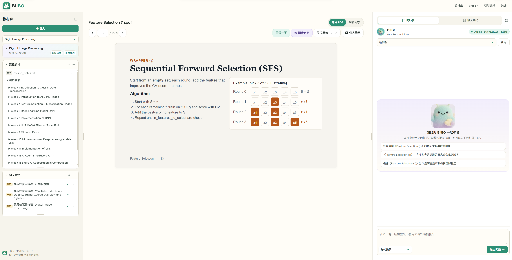
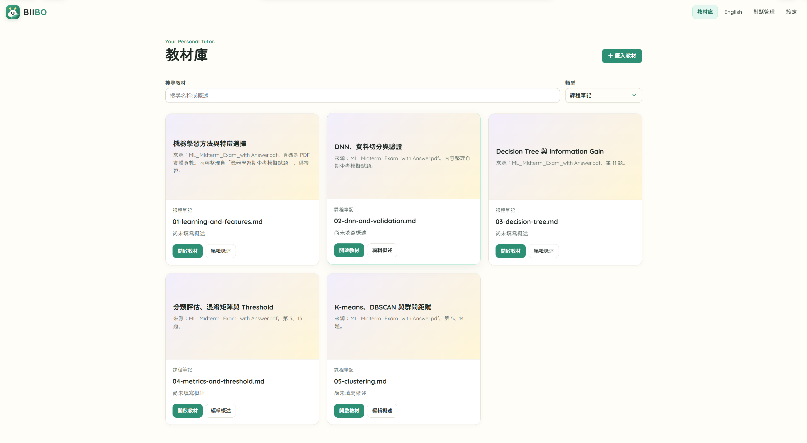
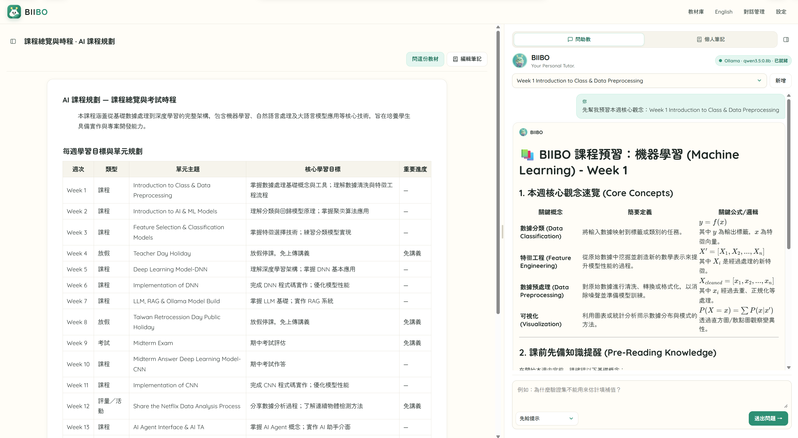
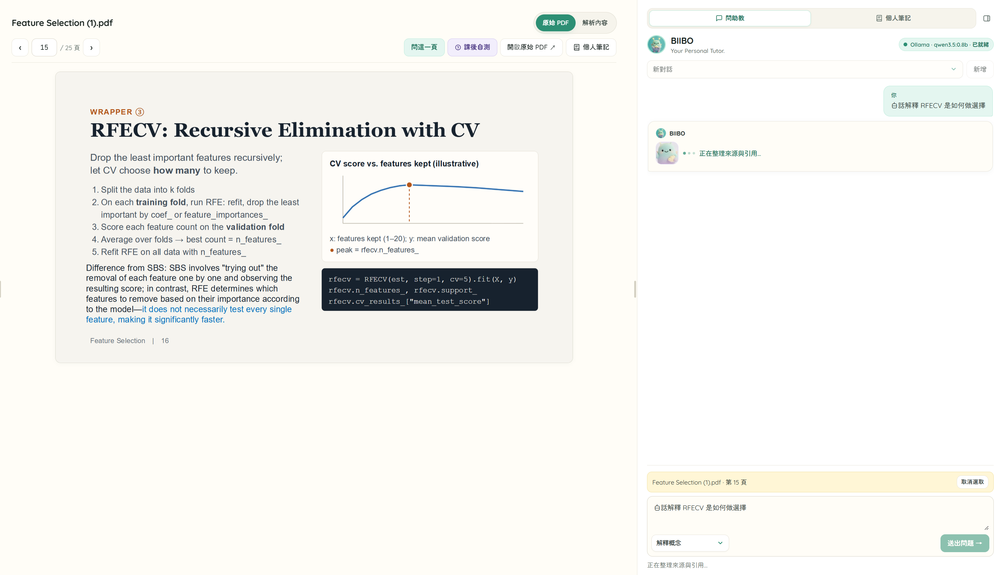
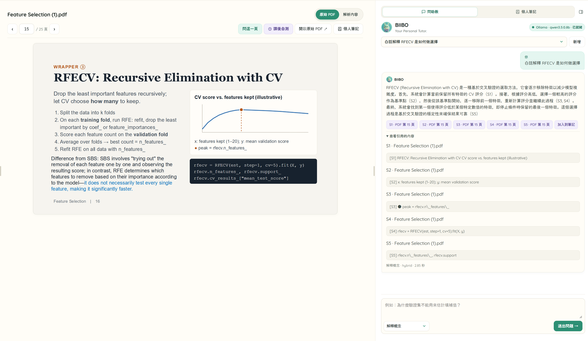
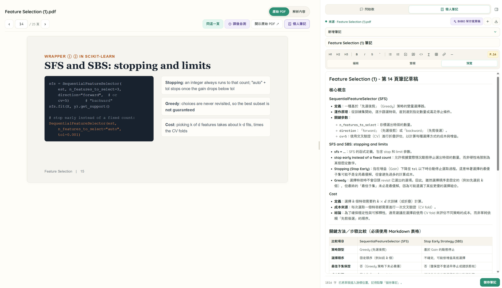
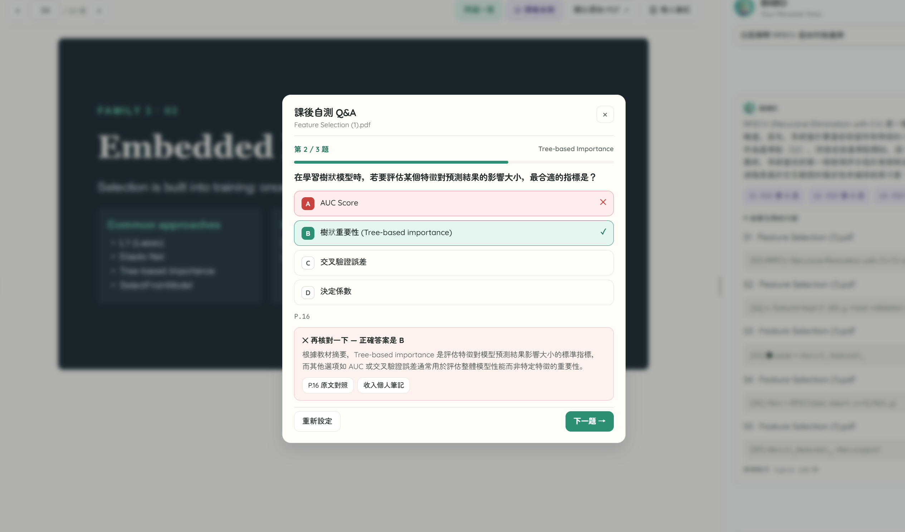
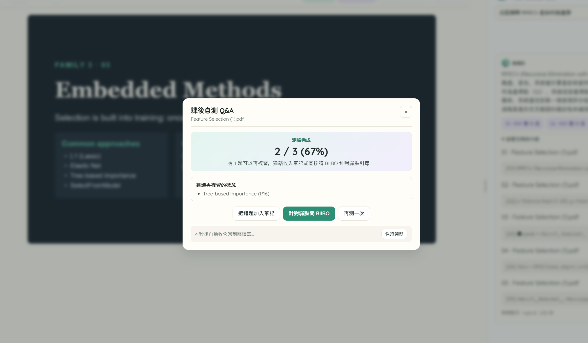

# BIIBO · Local Personal AI Tutor

[English](../README.md) | **繁體中文**

> **專為學生與研究者打造的本機個人 AI 助教與課程工作區** —— 將 PDF 閱讀、MinerU 結構化解析、課綱自動化規劃、附頁碼引用的蘇格拉底問答、Markdown／KaTeX 筆記與課後自測整合在同一個本機環境中。

BIIBO 將講義、PDF、筆記與 AI 問答整合在同一個工作區，支援依課程整理，並可從具備頁碼的來源跳回原文對照。

---

## 功能亮點與 Demo

### 1. 三欄式學習工作區與教材庫

在 `/library` 以卡片視圖搜尋、篩選並整理所有課程與教材；進入工作區後，左欄集中管理多門課程與每週單元資料夾，中欄可在「原始 PDF」與「解析內容」間同步頁碼切換並提供四色畫記，右欄隨時與 BIIBO 互動學習。

**三欄式學習工作區**



**教材庫（`/library`）**



### 2. 課綱三階段自動化規劃與每週課前預習

上傳課程大綱（支援 PDF、截圖圖片、剪貼簿直接 `Ctrl+V`／`Cmd+V` 貼圖、Markdown 或 TXT），即可一鍵執行 **「MinerU 解析 → LLM 自動規劃 → 建立分類與置頂總覽筆記」** 三階段流程。系統會彈性依照實際課綱編排（不綁定固定週數），自動略過放假、純考試與互評週的空講義資料夾，並可一鍵觸發附帶 KaTeX 公式整理的每週課前預習。



### 3. 附原文頁碼引用的 AI 助教（提示／概念／除錯／直接提問）

點擊 **「問這一頁」** 或反白講義段落，可依需求切換 **先給提示**、**解釋概念**、**協助除錯** 或 **直接提問** 模式。有可用證據時，回答可附引用標籤（`S1`、`S2`…）及原文摘錄；證據不足時助教可能不作答。引用標號只能指出來源，不能保證回答正確或確實受到來源支持，請對照原文。

「助教設定 → 進階 AI 設定」可選自動或進階模式。進階模式可設定 context、輸出上限、檢索 Top-k 與 temperature；自動模式根據 context 和問題長度調整候選數。Ollama 的模型上限取自本機 metadata；Gemini 已設定金鑰時會向 Google 查詢個別的輸入與輸出 token 上限，查詢失敗或其他未支援的引擎則標示未知。系統用 UTF-8 位元組與保留空間估算輸入預算，優先保留當前問題與教材，放不下的完整歷史輪次會省略並提示；這並非模型專用 tokenizer，不能保證不會超出各供應商的實際限制。CLI 模型的輸出長度與 temperature 由 CLI 控制。檢索、生成與引用仍須依實際教材及模型結果驗證。

頁碼只有在來源 PDF 的解析區塊存在對應頁面時才顯示；無法核實時改顯示教材段落並提示。引用筆記時可開啟筆記及其明示、且存在於原 PDF 的單一頁碼；目前不會自動展開頁碼範圍。這只能確認頁面存在，無法保證整段筆記均由該頁支持，跨頁來源仍需人工核對。部分供應商或模型可能忽略 temperature 等參數。

若 Ollama 明確回報模型僅支援 embedding，設定頁會提示其不支援文字生成，問答也會要求改選模型。模型能力未回報時不會自行猜測。

| 思考過程顯示 | 附頁碼引用與原文摘錄的回答 |
| :---: | :---: |
|  |  |

### 4. Markdown ＋ KaTeX 個人筆記與「BIIBO 幫你寫草稿」

在右側直接開啟個人筆記，支援 **編輯 / 雙欄 / 預覽** 三種模式與完整 LaTeX 數學公式（`$...$`／`$$...$$`）。點擊 **「BIIBO 幫你寫草稿」** 可針對「目前頁面」或「整份教材」（長文件自動分頁均勻抽樣）生成結構化重點、公式推導或比較表格，預覽確認後再插入或附加至筆記；已儲存的筆記也會自動納入後續問答檢索。



### 5. 專注課後自測 Q&A 與弱點追蹤

可依「目前頁面」或「整份 PDF」快速生成 3 題或 5 題互動自測。作答過程提供分步提示、即時解析與 **原文頁碼跳轉**（跳回講義對照時會自動暫存作答進度）；完成測驗後可一鍵把錯題加入筆記，或針對弱點觀念直接向 BIIBO 追問。

| 互動自測與原文對照 | 測驗總結與弱點複習引導 |
| :---: | :---: |
|  |  |

### 6. 多 AI 模型引擎與本機隱私優先

在 **「助教設定」** 中可自由切換偏好的模型引擎，並獨立設定介面語言與助教回應語言（繁體中文／English）：

| 引擎類型 | 支援來源 |
| :--- | :--- |
| **本地模型** | **Ollama**（預設）、**LM Studio** |
| **本機 CLI** | **Antigravity CLI**、**Claude Code**、**Codex CLI**（直接沿用本機 CLI 登入，支援推理強度與 Fast 模式） |
| **雲端 API** | **Gemini**、**OpenAI**、**Claude**、**OpenCode**、**DeepSeek**、**OpenRouter** |

所有教材、分類、筆記、對話與課綱資料皆保存在本機 `./data/biibo-store.json` 與 `./data/blobs/`。

---

## PDF 解析引擎：MinerU

BIIBO 預設採用 **[MinerU](https://github.com/opendatalab/MinerU)** 作為本機 PDF 與課綱截圖的解析引擎（預設位址 `http://127.0.0.1:8000`，可透過 `.env` 中的 `AITA_MINERU_URL` 調整）。

**為什麼使用 MinerU？**
- 精準還原學術論文與投影片的多欄版面、表格、圖片與 LaTeX 數學公式，並對應至正確的 PDF 實體頁碼。
- 內建 OCR 讀圖能力，支援掃描版 PDF 與課綱圖片截圖（`PNG` / `JPG` / `WebP` / 剪貼簿貼上）直接解析。
- 若本機 MinerU 尚未啟動，一般文字型 PDF 會自動退回內建 **PDF.js** 解析（也支援將 PDF 搭配既有的 MinerU 解析 `.zip` 壓縮檔直接匯入）。

### 給 AI Agent 的本機 MinerU 一鍵部署 Prompt

若想讓本機的 Coding Agent（如 **Claude Code**、**Codex CLI**、**Antigravity** 或 **Cursor**）幫你自動安裝並啟動 MinerU，直接複製以下 Prompt 貼上即可：

```text
請幫我在這台電腦部署供 BIIBO（Local Personal AI Tutor）使用的本機 MinerU HTTP API 服務：

1. 先偵測我的作業系統、Python 版本與硬體環境（NVIDIA CUDA GPU、Apple Silicon MPS 或純 CPU），選擇最適合的 MinerU 安裝方式（優先使用 `uv` 或獨立的 Python 虛擬環境）。
2. 安裝對應的 MinerU 套件（例如 `mineru[all]` 或符合我硬體的官方套件），並完成所需的 OCR／版面模型初始化。
3. 啟動本機 MinerU HTTP API 服務並綁定 loopback 8000 埠（`http://127.0.0.1:8000`，例如 `mineru-api --host 127.0.0.1 --port 8000` 或對應版本的 API 啟動指令）。
4. 測試 `GET http://127.0.0.1:8000/openapi.json`，確認回傳的 OpenAPI 規格中有提供 `/file_parse` 或 `/v1/tasks` 端點。
5. 檢查此專案根目錄的 `.env`（若不存在請從 `.env.example` 複製），確認已設定 `AITA_MINERU_URL=http://127.0.0.1:8000`。
6. 最後給我一行日後重新啟動 MinerU 服務用的指令。
```

---

## 快速上手（Quick Start）

### 環境需求

- **Node.js 22+**（建議 Node.js 24）與 **Bun**（或 `npm`）
- **Ollama**（完全本機運行）—— 或任一支援的本機 CLI／雲端 API
- *（選配）* 本機 **MinerU** 服務（`http://127.0.0.1:8000`），用於高精準度公式、表格與圖片 OCR 解析

### 安裝與啟動

1. **安裝依賴並下載預設本地模型**（確認 Ollama 已啟動）：

```bash
# 使用 Bun（推薦）
bun install --frozen-lockfile
ollama pull qwen3.5:0.8b
bun run start
```

```bash
# 或使用 npm
npm install
ollama pull qwen3.5:0.8b
npm run start
```

2. *（選配）* **啟用語意檢索（Dense）與混合檢索（Hybrid RRF）**（TF-IDF 無需額外模型即可直接使用）：

```bash
ollama pull bge-m3
```

預設的 `qwen3.5:0.8b` 適合作為輕量起點，但本機測試發現，即使找到相關教材也會出現重大事實錯誤。本工作區另測試 `qwen3.5:9b-q4_K_M` 搭配 Hybrid；它需要較多記憶體，仍可能出錯。硬體足夠時可執行 `ollama pull qwen3.5:9b-q4_K_M`，再於設定選擇該模型與 Hybrid；系統不會自動覆蓋既有偏好。

同一個 `data/` 目錄請只啟動一個 BIIBO 服務。更新後端程式後，請在原終端機停止既有服務，並從專案根目錄重新啟動；只重新整理瀏覽器不會載入新版後端。

3. **開啟瀏覽器開始使用**：

```text
http://127.0.0.1:3000/library
```

4. *（選配）* **自訂環境變數**：

```bash
cp .env.example .env
```

可在 `.env` 中調整 `HOST`、`PORT`、`OLLAMA_URL`、`LMSTUDIO_URL`、`AITA_MINERU_URL` 或伺服器端雲端 API 金鑰。

### 常見操作速查

| 使用情境 | 操作方式 |
| :--- | :--- |
| **匯入 PDF 或 MinerU ZIP** | 點擊 **「+ 匯入」**，上傳 PDF（由本機 MinerU 自動解析，離線時自動改用 PDF.js），或同時選擇 PDF 與 MinerU 產出的 `.zip` 解析包。 |
| **課綱自動化規劃** | 開啟 **「匯入 → 課綱規劃」**，上傳 PDF／截圖、直接貼上剪貼簿圖片（`Ctrl+V`／`Cmd+V`）或貼上大綱文字，點擊 **「開始 AI 規劃」** 即可自動完成三階段建置。 |
| **讓課程筆記連回 PDF 頁碼** | 在 UTF-8 Markdown 的標題下一行單獨寫入 `<!-- page: N -->`（1 起算的 PDF 實體頁碼），匯入時指定對應的原始 PDF。 |
| **標記教師正式課程規定** | 匯入課程公告或評分規則時勾選 **「這份來源是教師發布的正式規定」**，讓助教回答規範問題時以正式公告為準。 |
| **切換 AI 模型引擎** | 開啟右上角 **「設定」**，可在 **本地模型**、**本機 CLI** 與 **雲端 API** 間即時切換並測試連線；於介面儲存的雲端金鑰會存在已被 Git 忽略的 `data/provider-keys.json`。 |
| **管理與匯出對話** | 開啟 **「對話管理」** 預覽歷史問答，並勾選批量匯出為 **AITA JSON** 或 **Markdown**。 |

### 從 Python AITA 升級與備份

- 首次啟動若尚未建立 `data/biibo-store.json`，BIIBO 會以唯讀模式讀取 `aita/data/aita.sqlite3`（或 `AITA_DATA` 指定的資料夾），自動遷移文件、片段、分類、筆記、對話與設定至 `data/biibo-store.json` 與 `data/blobs/`。
- 備份時請先停止 BIIBO，直接複製整個 `data/` 目錄（請妥善保管內含金鑰的 `data/provider-keys.json`）。
- 若需保留舊版 `127.0.0.1:8766` 的瀏覽器畫記與閱讀進度，可在 `.env` 中設定 `PORT=8766` 後再啟動。

### 網路存取與安全性

BIIBO 預設僅監聽本機 loopback（`127.0.0.1`）。若需於內網或遠端存取，請在 `.env` 設定 `HOST`、`BIIBO_ACCESS_TOKEN` 與精確的 HTTPS `BIIBO_PUBLIC_ORIGIN`，並搭配保留公開 `Host` 標頭的反向代理使用（瀏覽器登入帳號為 `biibo`、密碼為 token；API 可使用 `Authorization: Bearer <token>`）。

### 本機驗證

```bash
bun run build
bun run test
# 或：npm run build && npm test
```

測試使用隔離的暫存資料目錄。若資料庫參照的本機檔案遺失，伺服器會停止啟動以避免進一步損失；請先從備份還原缺失檔案。

---

## 貢獻與授權（Contributing & License）

歡迎提交 Issue 回報問題、提出功能建議，或發送 Pull Request 參與開發！

### 參與開發流程

1. Fork 本專案並建立開發分支（`git checkout -b feat/your-feature`）。
2. 提交 PR 前，請先於本機確認型別檢查與單元測試皆通過：
   ```bash
   bun run build
   bun run test
   ```
3. 回報 Bug 時請一併提供作業系統、Node／Bun 版本、使用的模型引擎與重現步驟；大型架構調整建議先開 Issue 討論。

### 致謝

本專案使用 [PDF.js](https://github.com/mozilla/pdf.js)、[KaTeX](https://katex.org/) 與 [MinerU](https://github.com/opendatalab/MinerU)，設計理念參考 [OpenTutor](https://github.com/zijinz456/OpenTutor) 與 [haiku.rag](https://github.com/ggozad/haiku.rag)。

### 開源授權

本專案採用 **MIT License** 開源授權。
